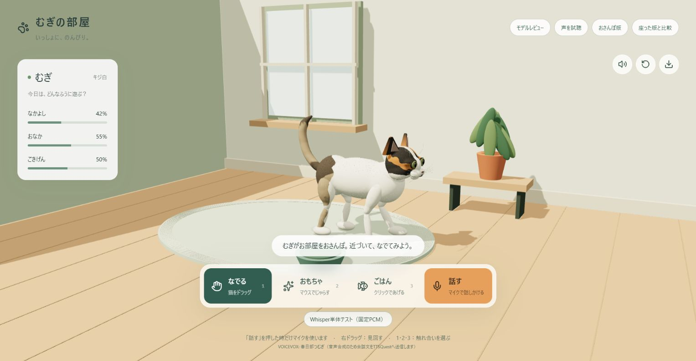
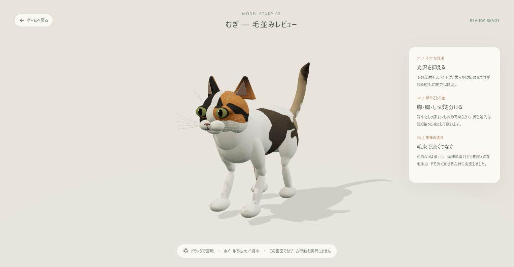
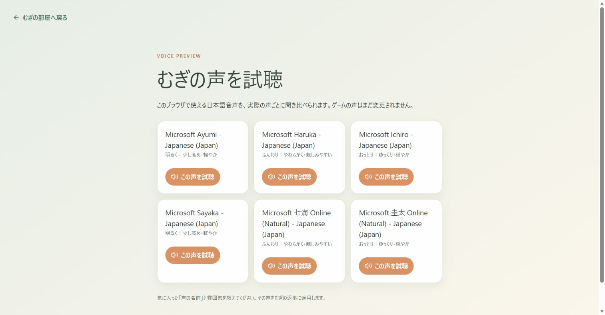
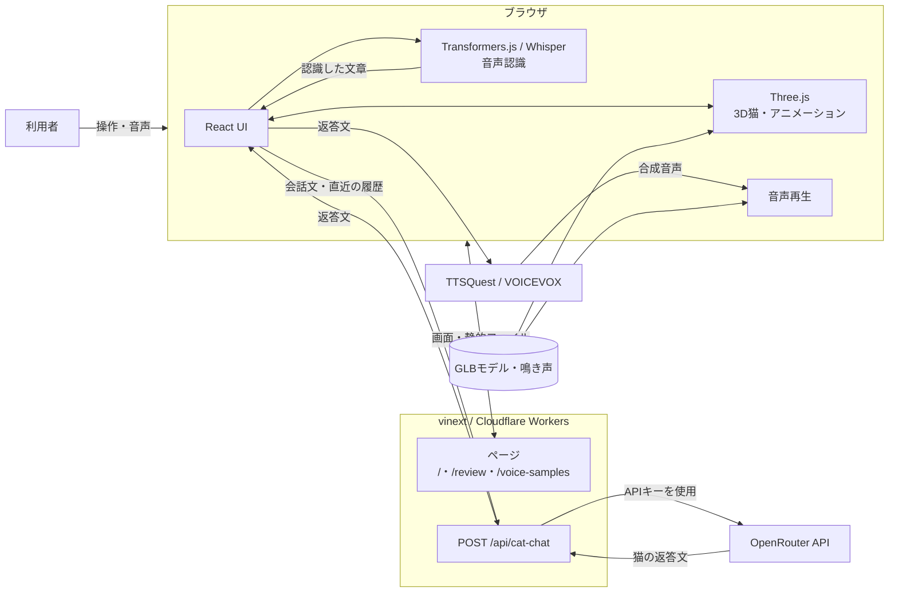

# むぎの部屋

3Dの猫「むぎ」とブラウザ上で触れ合えるWebアプリです。猫をなでる、おもちゃで遊ぶ、ごはんをあげるといった操作に加え、マイクで話しかけて会話できます。

## 主な機能

- Three.jsによる3D猫モデルの表示とアニメーション
- なでる・おもちゃ・ごはんのインタラクション
- カメラ操作、消音、3Dモデルのダウンロード
- ブラウザ内Whisperによる日本語音声認識
- OpenRouterを利用した猫との会話
- TTSQuest / VOICEVOX（春日部つむぎ）による音声応答
- 猫モデルのレビュー画面と音声サンプル画面

## スクリーンショット

### むぎの部屋



猫の状態を見ながら、なでる・おもちゃ・ごはん・会話を選べます。画面内を歩くむぎをドラッグしてなでたり、視点を動かして部屋を眺めたりできます。

| 3Dモデルレビュー | 音声サンプル |
| --- | --- |
|  |  |
| 毛並み、模様、光沢をさまざまな角度から確認できます。 | 利用可能な日本語音声を聞き比べられます。 |

## 構成図



音声認識はブラウザ内で処理されます。認識後の文章のみが会話APIへ送られ、返答文は音声合成サービスへ送られます。

## 必要環境

- Node.js 22.13.0以上
- npm
- ChromeまたはEdge推奨
- 会話機能を使う場合はOpenRouter APIキー

## セットアップ

依存パッケージをインストールします。

```bash
npm install
```

会話機能を使用する場合は、プロジェクト直下に`.dev.vars`を作成します。

```env
OPENROUTER_API_KEY=your_openrouter_api_key
```

`.dev.vars`や`.env*`はGitの追跡対象外です。APIキーをコミットしないでください。

## 開発サーバー

```bash
npm run dev
```

ターミナルに表示されたローカルURLをブラウザで開いてください。音声入力にはブラウザのマイク利用許可が必要です。初回の音声認識ではWhisperモデルの読み込みに時間がかかる場合があります。

## 操作方法

- `1`: なでるモード
- `2`: おもちゃモード
- `3`: ごはんモード
- 右ドラッグ: 視点を動かす
- 「話す」ボタン: 録音を開始／停止する

## ページ

- `/`: むぎの部屋
- `/?model=seated`: 座ったモデルとの比較
- `/review`: 3Dモデルのレビュー
- `/voice-samples`: 日本語音声の試聴

## コマンド

```bash
npm run dev      # 開発サーバーを起動
npm run build    # 本番用にビルド
npm run start    # ビルド済みアプリをWranglerで起動
npm run lint     # Oxlintで検査
npm run format   # Oxfmtで整形
```

本番用アプリを起動する場合は、先に`npm run build`を実行してください。

## 技術構成

- React 19
- vinext / Vite
- Three.js
- Tailwind CSS
- Cloudflare Workers / Wrangler
- Hugging Face Transformers.js
- OpenRouter API
- TTSQuest / VOICEVOX

## 外部サービスとデータ送信

- 会話文は応答生成のためOpenRouterへ送信されます。
- 生成された返答文は音声合成のためTTSQuestへ送信されます。
- 音声認識はブラウザ内で実行されます。

## 素材

猫の鳴き声`public/audio/meow.ogg`はIgnasDによるCC0素材です。詳細は`public/audio/CREDITS.txt`を参照してください。
