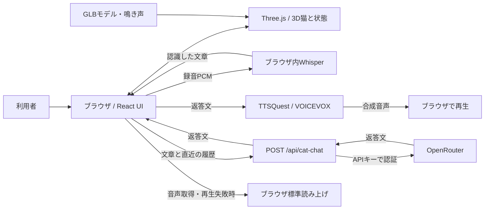

# むぎの部屋

## 利用者の困りごとと、このツールでの解決方法

| 想定される困りごと | このツールでできること |
| --- | --- |
| 猫と触れ合う雰囲気をブラウザで楽しみたい | 3Dの猫「むぎ」をなでる、おもちゃで遊ぶ、ごはんをあげる操作ができます。 |
| 猫に話しかけて反応を楽しみたい | マイク入力を日本語の文章に変換し、猫として生成された返答を画面と音声で受け取れます。会話にはAPIキーが必要です。 |
| 猫モデルの見た目や音声を確認したい | モデルレビューで毛並みを眺め、日本語音声サンプルを聞き比べられます。音声の試聴結果をゲームへ適用する機能はありません。 |

## アプリケーション概要

猫との触れ合いを楽しみたい人や、3Dペットと音声会話の表現を確認したい開発者向けのWebアプリです。小さな3Dの部屋で猫と遊び、状態の変化や短い会話を楽しむことを目的としています。

アカウント登録やセーブ機能は実装されていません。3Dの触れ合いはOpenRouter APIキーなしでも利用できます。

## 主な機能

- **3D猫との触れ合い**：なでる・おもちゃ・ごはんのモードを選び、愛情・満腹・楽しさの状態を確認できます。
- **視点とモデルの操作**：視点の回転・リセット、猫の鳴き声の消音、猫の3Dモデルのダウンロードができます。消音ボタンは鳴き声を制御し、会話音声には連動しません。
- **日本語の音声会話**：「話す」で録音し、「止める」または12秒経過で音声認識を開始します。ブラウザ内Whisperで文字に変換し、OpenRouterで返答を生成します。
- **音声応答**：TTSQuest経由のVOICEVOX（春日部つむぎ、speaker 8）で返答を再生します。取得・再生に失敗するとブラウザ標準の読み上げを試みます。
- **モデルレビュー**：ゲーム行動を実行せず、ドラッグで回転、ホイールで拡大・縮小してモデルを確認できます。
- **音声サンプル**：ブラウザで利用可能な日本語音声を、速度や高さを変えて試聴できます。
- **音声認識の診断**：画面の「Whisper単体テスト（固定PCM）」で既存の鳴き声音声を入力し、処理段階を確認できます。認識結果が空でなければ会話APIまで進む実装です。

## 画面・利用イメージ


| モデルレビュー | 音声サンプル |
| --- | --- |
|  |  |

| ページ | 用途 |
| --- | --- |
| `/` | むぎの部屋。右ドラッグで見回し、`1`・`2`・`3`でなでる・おもちゃ・ごはんを選択。 |
| `/?model=seated` | 座ったモデルとの比較。 |
| `/?model=original` | 元モデルとの比較。 |
| `/review` | 毛並み・質感のレビュー。 |
| `/voice-samples` | ブラウザの日本語音声を試聴。 |

## 技術スタック

| 分類 | 使用技術 |
| --- | --- |
| 言語 | TypeScript、CSS |
| UI | React 19、shadcn系UI、Base UI、Lucide |
| フレームワーク・ビルド | vinext 1.0.0-beta.5、Vite 8 |
| スタイル | Tailwind CSS 4 |
| 3D・音声再生 | Three.js、Web Audio API |
| 音声認識 | Transformers.js 3、`onnx-community/whisper-tiny`（q8） |
| サーバー実行環境 | Cloudflare Workers、Cloudflare Viteプラグイン、Wrangler |
| 会話・読み上げ | OpenRouter API、TTSQuest / VOICEVOX、Web Speech API |
| 品質・コミット検査 | Oxlint、Oxfmt、GitSecurityTool / pre-commit |

DB・永続ストレージは使用していません。正確な依存バージョンは[package.json](./package.json)と[package-lock.json](./package-lock.json)を参照してください。

## システム構成



React画面とThree.jsがブラウザで動作し、vinext / WorkersがページとAPIを提供します。録音を16kHzのPCMへ変換してWhisperに渡し、認識した文章を会話APIへ送ります。APIは秘密キーを付けてOpenRouterへ問い合わせ、返答をブラウザへ返します。ブラウザが返答文をTTSQuestへ送り、音声を取得します。

`POST /api/cat-chat`は1〜600文字のメッセージと直近最大6件の履歴を受け付けます。モデル指定はコード内の`inclusionai/ling-3.0-flash-vl:free`です。空の返答を受け取った場合は1回再試行します。

別途`POST /api/cat-voice`も実装されています。Base64形式のWebM音声をOpenRouterで文字起こしし、会話応答を返すAPIですが、現在のメイン画面からは呼び出していません。通常の画面操作では録音音声をこのAPIへ送信しません。

## 構成のポイントと採用理由

以下はコードから確認できる責務分担と、その効果・制約です。技術選定時の比較や採用経緯は、既存資料・コードでは確認できません。

- **ブラウザ側の3D描画**：Three.jsが描画と猫の動作を担当し、Reactがボタンや状態表示を担当します。操作に応じた描画を端末上で処理する構成で、性能は端末の描画能力に依存します。
- **ブラウザ内の音声認識**：通常の会話では録音PCMをWhisperへ渡し、認識文をサーバーへ送ります。音声認識モデルの初回取得と端末上の推論処理が必要です。現行画面はTransformers.jsを直接呼び出しており、専用Workerによる処理分離は行っていません。
- **APIキーのサーバー管理**：OpenRouter呼び出しはWorkersのバインディングからキーを読み込みます。ブラウザへAPIキーを渡す実装ではありません。
- **読み上げのフォールバック**：TTSQuestが利用できない場合はWeb Speech APIを試みます。音声の種類・品質はブラウザとOSに依存します。
- **メモリ内の状態保持**：猫の状態や会話履歴は実行中の画面内で保持します。DB初期化は不要ですが、再読み込み後の復元や端末間同期はできません。
- **番号付きのフォルダ分割**：プロジェクト作成ルールに合わせ、資料・実装・記録を分離しています。Viteの`appDir`・`publicDir`とTypeScriptのエイリアスで`02.src/`を参照します。

## DB構造

現行実装にDBスキーマ、テーブル、マイグレーションはありません。[hosting.json](./.openai/hosting.json)のD1・R2設定はいずれも`null`で、Vite設定もバインディングを作成しません。このため主キー・外部キー・リレーション・ER図は該当しません。

会話履歴はReactの参照値として直近6件を保持し、猫の状態もブラウザ内で管理します。アプリの保存処理は実装されていません。

## セットアップ方法

### 前提条件

- Node.js 22.23.3（22系）、npm、Git。.nvmrcに検証済みバージョンを指定しています。
- WebGLと音声APIを利用できるブラウザ（ChromeまたはEdgeを想定）。
- 音声認識モデルの取得、会話、外部音声合成にはインターネット接続。
- 会話機能を利用する場合はOpenRouter APIキー。
- コミット検査を有効にする場合はPython 3.11以上（Windowsでは`py`コマンド）。

### 依存関係と設定

プロジェクトルートで実行します。

```bash
git submodule update --init --recursive
npm ci
```

新規cloneでは`git clone --recurse-submodules <repository-url>`でサブモジュールも取得できます。DB初期設定は不要です。

会話機能を使用する場合は、ルートに`.dev.vars`を作成します。以下は値を含まない設定例です。

```dotenv
OPENROUTER_API_KEY=
```

`=`の後に自分のキーをローカルで設定します。`00.secret/`は秘密情報の保管場所ですが、自動で読み込まれる場所ではありません。

### 開発サーバー

```bash
npm run dev
```

表示されたURL（通常は`http://localhost:3000/`）を開きます。「話す」を押した際にマイクの利用を許可してください。PowerShellで`npm.ps1`の実行が制限される場合は、`npm.cmd run dev`を使用できます。

### コミット検査

検査用PythonとGitleaksはプロジェクト内のGit除外済みwork/へ導入済みです。システムのpyコマンドは不要です。

```powershell
./work/python-embed/python.exe 02.src/tools/install_checks.py
./work/python-embed/python.exe 02.src/tools/run_checks.py
```

追跡済み・未追跡（Git除外を除く）の全ファイルを検査します。独自の検知語は00.secret/security-keywords.jsonへ設定し、サブモジュールは変更しません。再構築・実行手順は[セキュリティ検査](./01.doc/security-checks.md)、検証状況は[検証結果](./01.doc/検証結果.md)を参照してください。

## 環境変数

| 変数名 | 用途 | 必須 |
| --- | --- | --- |
| `OPENROUTER_API_KEY` | `/api/cat-chat`・`/api/cat-voice`からOpenRouterへ接続するキー。ローカルではルートの`.dev.vars`に設定。 | 会話APIを使用する場合のみ必須。未設定時は503を返します。 |

TTSQuestへの呼び出しに、この実装はAPIキーを付けていません。モデル名も環境変数ではなくコード内の指定です。

Vite設定では開発ツール用に`WRANGLER_WRITE_LOGS=false`、`WRANGLER_LOG_PATH=.wrangler/logs`、`MINIFLARE_REGISTRY_PATH=.wrangler/registry`を未指定時の値として設定します。通常は手動設定不要です。`CODEX_SANDBOX=seatbelt`の場合のみファイル監視をポーリング方式に切り替えます。

`.dev.vars*`・`.env*`・`00.secret/`はGit管理外です。秘密値をREADMEや作業記録へ記載しないでください。

## 利用可能なコマンド

| コマンド | 用途 |
| --- | --- |
| `npm run dev` | vinext開発サーバーを起動。 |
| `npm run build` | 本番用ビルドを生成。 |
| `npm run start` | ビルド生成後の`dist/server/wrangler.json`を使用し、Wranglerでローカル実行。公開用のコマンドではありません。 |
| `npm run lint` | Oxlintによるコード・型の検査。 |
| `npm run format` | Oxfmtによる整形（ファイルを書き換えます）。 |
| `py -m pre_commit run --all-files` | セキュリティ等のコミット検査。事前セットアップが必要。 |

自動テスト用のnpmスクリプト、DB操作用コマンドはありません。検証項目は[構成と検証](./01.doc/構成と検証.md)、既知の問題は[残課題](./03.log/leftover_tasks.txt)を参照してください。

## ドキュメント・設計書

- [プロジェクト作成ルール](./01.doc/プロジェクト作成ルール.txt)
- [README作成プロンプト](./01.doc/ReadMe作成プロンプト.txt)
- [構成と検証](./01.doc/構成と検証.md)
- [再利用プロンプト](./03.log/prompts.txt)
- [現在の進捗](./03.log/current_status.txt)
- [残課題・未検証事項](./03.log/leftover_tasks.txt)
- [GitSecurityToolの説明](./GitSecurityTool/README.md)

独立した要件定義書・DB設計書は現時点ではありません。

## デプロイ方法

Cloudflare Workers向けのVite設定とSitesのホスティング設定は存在しますが、リポジトリ内に公開用のnpmスクリプトや、検証済みのデプロイ手順はありません。`npm run start`はWranglerによるローカル実行です。

WindowsのNode.js 24.11.1ではビルドプロセスが異常終了（0xC0000409）しました。Node.js 22.23.3では本番ビルドの成功を確認済みです。22系へ切り替え、`node --version`を確認してから`npm run build`を実行してください。nvmを使用する場合は`nvm install 22.23.3`、`nvm use 22.23.3`で切り替えます。システムのNode.jsは今回変更していません。公開先のSecret設定も含めたデプロイ手順は未検証です。

## 制約・注意事項

- アプリ独自の利用者認証、会話APIの利用者別制限、セーブ・履歴復元は実装されていません。
- マイク入力には利用許可と安全なコンテキスト（HTTPSまたはlocalhost）が必要です。録音は最長12秒で停止します。
- 通常の会話経路は認識文と履歴をOpenRouterへ、返答文をTTSQuestへ送信します。別実装の`/api/cat-voice`を直接使う場合は録音音声もOpenRouterへ送られます。標準読み上げの処理先はブラウザ・OSの音声実装によります。
- 音声診断のコンソール出力には認識文が含まれます。ログ共有時は内容を確認してください。
- 初回のWhisperモデル取得には時間がかかり、推論速度は端末に依存します。オフラインでの全機能動作は保証していません。
- 外部サービスや指定モデルの提供状況・利用制限により会話や音声合成に失敗する場合があります。コード内の`:free`表記はモデル指定であり、利用条件を保証するものではありません。
- 音声サンプルは試聴専用で、選択した声をゲームへ適用・保存しません。
- Node.js 22.23.3でビルド成功を確認しました。Lint指摘は修正し、検査成功を確認しました。Python・検査フックは導入済みです。3D操作・マイク会話・外部サービス連携の手動確認も未完了です。詳細は[残課題](./03.log/leftover_tasks.txt)を参照してください。

## ディレクトリ構成

```text
project-root/
├── 00.secret/                   # ローカル専用、Git管理外
├── 01.doc/                      # ルール・構成資料
├── 02.src/
│   ├── app/                     # 画面とAPIルート
│   ├── components/              # UI部品
│   ├── hooks/                   # Reactフック
│   ├── lib/                     # 3D・移動・音声処理
│   └── public/                  # モデル・音声・スクリーンショット
├── 03.log/                      # プロンプト・進捗・残課題
├── GitSecurityTool/             # セキュリティ検査サブモジュール
├── .openai/hosting.json         # ホスティング設定
├── .pre-commit-config.yaml      # コミット検査設定
├── .gitignore
├── package.json
├── package-lock.json
├── tsconfig.json
├── vite.config.ts
└── README.md
```

設定ファイルとnpmコマンドの実行場所はルートです。`02.src/public/`配下の素材は、ブラウザでは`/models/...`や`/audio/...`のURLで配信されます。

## ライセンス

プロジェクト全体のライセンスファイル・ライセンス指定は確認できず、未定義です。依存ライブラリや外部サービスにはそれぞれのライセンス・利用条件が適用されます。

猫の鳴き声`02.src/public/audio/meow.ogg`はIgnasDによるCC0 1.0素材です。出典とライセンスは[音声クレジット](./02.src/public/audio/CREDITS.txt)を参照してください。3Dモデルを含む他の素材の利用許諾は、この鳴き声のライセンスからは判断できません。
